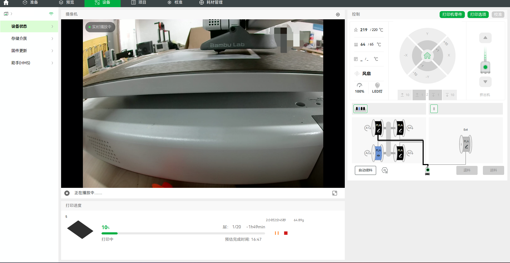
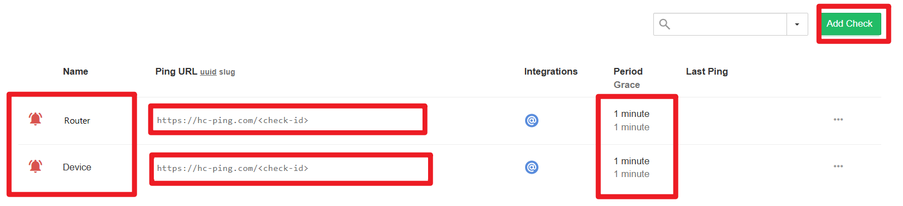

# esp32s3路由重庆大学校园网

用 ESP32-S3 接入重庆大学 2.4 GHz 校园网，为手机、打印机等设备提供上网热点。拓竹 A1 联网后可通过 Bambu 云远程打印。

## 项目特点

- 支持 DHCP、DNS 转发和 IPv4 NAT，校园网掉线后自动重连。
- 支持通过热点手动登录校园网，在 `192.168.77.1` 查看连接状态和设备数。
- 支持可选的邮件提醒，通知路由器掉线与恢复，以及首台设备接入和最后一台设备离开。

## 实际效果

已在重庆大学校园网实测热点访问外网。拓竹 A1 成功上传模型并开始打印时，Bambu Studio 同时显示摄像头实时画面和打印进度，验证了这组模型上传与摄像头预览可以同时使用。Healthchecks.io 已验证设备上线、离线，以及路由器掉线与恢复的邮件提醒。

| 邮件提醒 | A1 实时摄像头与打印进度 |
| --- | --- |
|  |  |

未单独测量网络数值带宽。

## 配置与烧录

在 ESP-IDF 6.0.1 终端中运行以下命令，将 `COMx` 换成实际串口。在 `menuconfig` 的 **Campus Wi-Fi router configuration** 中设置热点密码，校园网 SSID 默认为 `CQU_WiFi`。

```powershell
idf.py set-target esp32s3
idf.py menuconfig
idf.py -p COMx flash monitor
```

手机连接开发板热点后，打开 [重庆大学校园网认证页](http://login.cqu.edu.cn/) 登录。

## 配置邮件提醒

在 Healthchecks.io 点 **Add Check**，新建 `Router` 和 `Device`，将 **Period** 和 **Grace** 都设为 1 分钟，并关联 **Email** 集成。以 [Healthchecks.io 配置说明](https://healthchecks.io/docs/configuring_checks/) 为准。



从 [配置模板](main/links.example.h) 创建 `main/links.local.h`，分别填入两个检查的 Ping URL，然后重新烧录。Git 会忽略本地链接配置。
